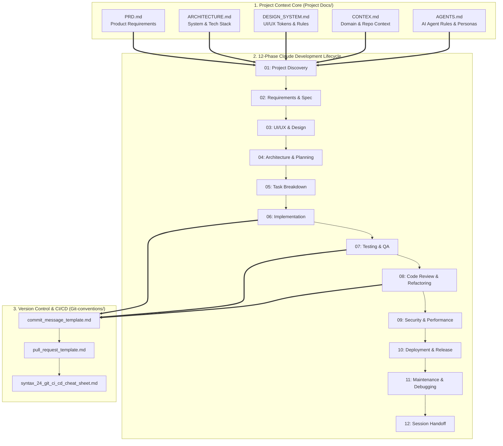
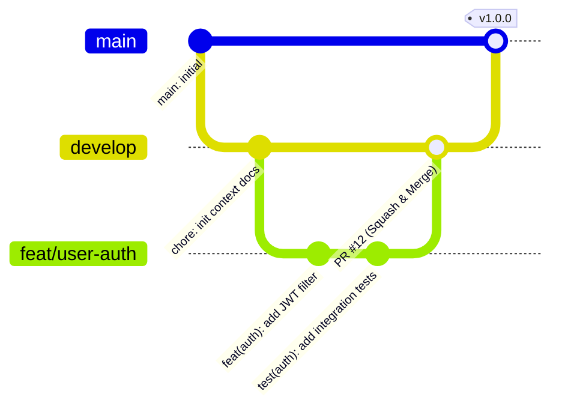

# Company Engineering Workflows, Standards & AI Conventions

```text
 __      __            __     _____.__
/  \    /  \__________|  | ___/ ____\  |   ______  _  ________
\   \/\/   /  _ \_  __ \  |/ /\   __\|  |  /  _ \ \/ \/ /  ___/
 \        (  <_> )  | \/    <  |  |  |  |_(  <_> )     /\___ \
  \__/\  / \____/|__|  |__|_ \ |__|  |____/\____/ \/\_//____  >
       \/                   \/                              \/
      [ COMPANY ENGINEERING STANDARDS & AI LIFECYCLE PLAYBOOK ]
```

Welcome to the central **Engineering Workflows & Standards** repository[cite: 2]. This repository defines our company-wide conventions for AI-assisted software engineering (Claude Development Lifecycle), project context documentation ("Vibe Coding" context files), and Git/CI-CD operational standards[cite: 2].

Every project across the organization must adopt these templates and lifecycle phases to ensure deterministic code quality, seamless agent handoffs, and clean version control[cite: 2].

---

## High-Level System Architecture

Our engineering standard is built on three pillars[cite: 2]:

1. **Project Context Foundation (`Project Docs/`)**: Structured Markdown context files that ground AI agents and engineers in the exact architecture, product requirements, and design system of a repository[cite: 2].
2. **12-Phase Claude Development Lifecycle (`claude/docs/claude-development-lifecycle/`)**: A standardized end-to-end execution pipeline from discovery to session handoff[cite: 2].
3. **Git & CI/CD Governance (`Git-conventions/`)**: Unified commit, pull request, and pipeline rules[cite: 2].



---

## Repository Directory Structure

```text
Workfows/
├── README.md                                           # Root Company Standards Index (This File)
├── claude/
│   ├── docs/
│   │   └── claude-development-lifecycle/               # 12-Phase AI Engineering Standard
│   │       ├── 01-project-discovery.md                 # Phase 1: Initial repo & domain discovery
│   │       ├── 02-requirements-and-specification.md    # Phase 2: Functional & non-functional specs
│   │       ├── 03-ui-ux-and-design.md                  # Phase 3: Wireframing & component design
│   │       ├── 04-architecture-and-technical-planni... # Phase 4: System design & schema planning
│   │       ├── 05-task-breakdown.md                    # Phase 5: Atomic sprint & agent tasks
│   │       ├── 06-implementation.md                    # Phase 6: Code generation & feature wiring
│   │       ├── 07-testing-and-quality-assurance.md     # Phase 7: Unit, integration & E2E verification
│   │       ├── 08-code-review-and-refactoring.md       # Phase 8: Static analysis & clean code audit
│   │       ├── 09-security-and-performance.md          # Phase 9: Vulnerability & latency hardening
│   │       ├── 10-deployment-and-release.md            # Phase 10: Staging/Production rollout
│   │       ├── 11-maintenance-and-debugging.md         # Phase 11: Log triage & RCA workflows
│   │       ├── 12-session-handoff.md                   # Phase 12: Context compaction & state handoff
│   │       ├── COMMANDS-QUICK-REFERENCE.md             # Verified Claude CLI commands & shortcuts
│   │       └── README.md                               # Lifecycle module overview
│   └── Project Docs/                                   # Claude-specific workspace templates
├── Git-conventions/                                    # Version Control & Release Governance
│   ├── commit_message_template.md                      # Standardized Conventional Commits format
│   ├── pull_request_template.md                        # PR checklist, testing proof & review gates
│   └── syntax_24_git_ci_cd_cheat_sheet.md              # Git branching, rebasing & CI/CD command reference
└── Project Docs/                                       # Mandatory Repository Context Files
    ├── AGENTS.md                                       # Agent operating rules, constraints & sub-agents
    ├── ARCHITECTURE.md                                 # High-level system topology, DB & module boundaries
    ├── CONTEX.md                                       # Active workspace state, domain glossary & env info
    ├── DESIGN_SYSTEM.md                                # Typography, color tokens, spacing & UI components
    ├── PRD.md                                          # Master Product Requirements Document
    └── Vibe_Coding_MD_Files_Guide.docx                 # Comprehensive guide on maintaining MD context files
```

---

## Pillar 1: Mandatory Project Context Files (`Project Docs/`)

Every active application repository in the company must maintain these 5 core Markdown files in its root or `docs/` directory so AI coding agents (Claude Code, Cursor, etc.) and human developers share a single source of truth[cite: 2]:

| File Name                                                   | Purpose & Ownership                                                                                               | When to Update                                                                             |
| :---------------------------------------------------------- | :---------------------------------------------------------------------------------------------------------------- | :----------------------------------------------------------------------------------------- |
| **[`PRD.md`](./Project%20Docs/PRD.md)**                     | Defines user personas, user stories, acceptance criteria (`Given/When/Then`), and explicit non-goals[cite: 1, 2]. | Before starting Phase 02 (`02-requirements-and-specification.md`)[cite: 2].                |
| **[`ARCHITECTURE.md`](./Project%20Docs/ARCHITECTURE.md)**   | Documents the tech stack, folder structure, data flow, database schema, and API boundaries[cite: 2].              | During Phase 04 (`04-architecture-and-technical-planning.md`) or major refactors[cite: 2]. |
| **[`DESIGN_SYSTEM.md`](./Project%20Docs/DESIGN_SYSTEM.md)** | Locks in UI tokens (colors, typography, spacing), accessibility rules, and reusable component states[cite: 1, 2]. | During Phase 03 (`03-ui-ux-and-design.md`)[cite: 2].                                       |
| **[`CONTEX.md`](./Project%20Docs/CONTEX.md)**               | Tracks current project status, active feature flags, environment nuances, and domain terminology[cite: 2].        | Continuously, and at every Phase 12 (`12-session-handoff.md`)[cite: 2].                    |
| **[`AGENTS.md`](./Project%20Docs/AGENTS.md)**               | Instructs AI coding tools on coding style, forbidden patterns, test commands, and verification gates[cite: 2].    | At project initialization and whenever build/lint commands change.                         |

> **Reference Guide:** Open [`Project Docs/Vibe_Coding_MD_Files_Guide.docx`](./Project%20Docs/Vibe_Coding_MD_Files_Guide.docx) for full instructions on authoring and linking these files across projects[cite: 2].

---

## Pillar 2: The 12-Phase Claude Development Lifecycle

Engineers must follow the sequential workflow inside [`claude/docs/claude-development-lifecycle/`](./claude/docs/claude-development-lifecycle/) when building new products or features[cite: 2]:

```text
+-----------------------------------------------------------------------------------+
| PHASE 01-04: DISCOVERY & DESIGN                                                   |
| [01 Discovery] -> [02 Requirements] -> [03 UI/UX Design] -> [04 Architecture]     |
+-------------------------------------------------------------------------+---------+
                                                                          |
                                                                          v
+-----------------------------------------------------------------------------------+
| PHASE 05-08: EXECUTION & QUALITY                                                  |
| [08 Review/Refactor] <- [07 Testing & QA] <- [06 Implementation] <- [05 Tasks]    |
+---------+-------------------------------------------------------------------------+
          |
          v
+-----------------------------------------------------------------------------------+
| PHASE 09-12: HARDENING, RELEASE & CONTINUITY                                      |
| [09 Security/Perf] -> [10 Deploy/Release] -> [11 Maintenance] -> [12 Handoff]     |
+-----------------------------------------------------------------------------------+
```

- **Discovery & Specification (`01` – `04`):** Never write application code before completing discovery (`01-project-discovery.md`), locking specifications (`02-requirements-and-specification.md`), aligning UI tokens (`03-ui-ux-and-design.md`), and mapping technical architecture (`04-architecture-and-technical-planning.md`)[cite: 2].
- **Atomic Execution (`05` – `08`):** Break features into small, testable work items (`05-task-breakdown.md`), implement with strict typing (`06-implementation.md`), verify with automated tests (`07-testing-and-quality-assurance.md`), and perform an AI + human diff review (`08-code-review-and-refactoring.md`)[cite: 2].
- **Production & Continuity (`09` – `12`):** Audit security and performance (`09-security-and-performance.md`), execute release checklists (`10-deployment-and-release.md`), triage production issues (`11-maintenance-and-debugging.md`), and always record session state in `12-session-handoff.md` so the next developer or AI session starts with zero context loss[cite: 2].
- **CLI Quick Reference:** Keep [`COMMANDS-QUICK-REFERENCE.md`](./claude/docs/claude-development-lifecycle/COMMANDS-QUICK-REFERENCE.md) open for daily terminal and slash-command operations[cite: 2].

---

## Pillar 3: Git & CI/CD Engineering Conventions (`Git-conventions/`)

All code contributions must strictly follow the templates in [`Git-conventions/`](./Git-conventions/)[cite: 2]:



1. **Commit Messages ([`commit_message_template.md`](./Git-conventions/commit_message_template.md)):**
   - Follow Conventional Commits (`feat:`, `fix:`, `docs:`, `refactor:`, `test:`, `chore:`).
   - Keep subject lines concise, imperative, and scoped to a single logical change.
2. **Pull Requests ([`pull_request_template.md`](./Git-conventions/pull_request_template.md)):**
   - Every PR must link to the relevant task from `05-task-breakdown.md`[cite: 2].
   - Include verification evidence (passing test output, screenshots for UI changes, and security checklist sign-off).
3. **Git & CI/CD Operations ([`syntax_24_git_ci_cd_cheat_sheet.md`](./Git-conventions/syntax_24_git_ci_cd_cheat_sheet.md)):**
   - Standardizes branch naming, interactive rebasing, conflict resolution, and CI/CD pipeline triggers[cite: 2].

---

## Quick Onboarding: How to Start a New Company Project

1. **Copy the Context Templates:**
   Copy all files from [`Project Docs/`](./Project%20Docs/) (`AGENTS.md`, `ARCHITECTURE.md`, `CONTEX.md`, `DESIGN_SYSTEM.md`, `PRD.md`) into the root of your new project repository[cite: 2].
2. **Configure Git Templates:**
   Copy [`pull_request_template.md`](./Git-conventions/pull_request_template.md) into your project's `.github/` directory and configure your local commit template using [`commit_message_template.md`](./Git-conventions/commit_message_template.md)[cite: 2]:
   ```bash
   git config commit.template Git-conventions/commit_message_template.md
   ```
3. **Execute the Claude Lifecycle:**
   Open [`claude/docs/claude-development-lifecycle/01-project-discovery.md`](./claude/docs/claude-development-lifecycle/01-project-discovery.md) and progress sequentially through Phase 12[cite: 2].
4. **End Every Coding Session Cleanly:**
   Before closing your IDE or terminal, run the checklist in [`12-session-handoff.md`](./claude/docs/claude-development-lifecycle/12-session-handoff.md) and update `CONTEX.md`[cite: 2].
